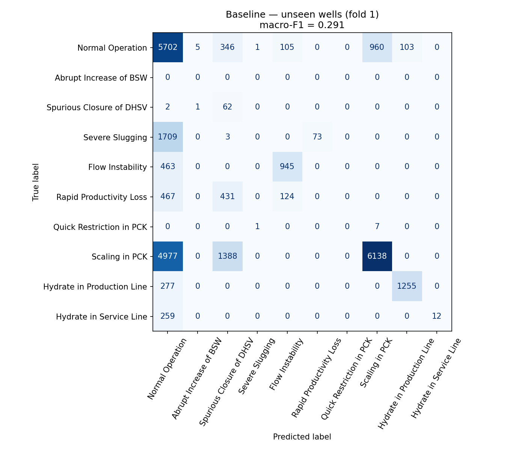

# 🛢️ WellSentinel-3W

[](https://github.com/alialhooti217-cmd/WellSentinel-3W/actions/workflows/tests.yml)


**An early-warning system for undesirable events in offshore oil wells, evaluated the way a control room would judge it: on wells it has never seen, in minutes of warning and false alarms per day.**

> Hydrates, scaling, severe slugging, flow instability and spurious valve closures cost operators hours of
> deferred production and put well integrity at risk. WellSentinel watches 27 subsea and topside sensors and
> raises an **explainable alarm, ideally while the event is still developing**.

Author: **Ali Al Hooti**, Chemical & Process Engineer (SQU)

---

## 💡 Why this project is new

Many public notebooks on the Petrobras 3W dataset report **very high accuracy**. Those numbers often come from a
*random* train/test split, so windows from the **same well** end up in both sets. The model memorises the
well's signature, which is not the same as learning the event's physics. In the field, a model is always deployed on a well whose data it has not
been trained on.

WellSentinel asks the **operator's question** instead:

> *On a well the model has never seen, how many events do we catch, how many minutes of warning do we get,
> and how many false alarms per day does the control room have to put up with?*

| Typical 3W notebook | WellSentinel-3W |
|---|---|
| Random train/test split (leaks well identity → inflated scores) | **Well-grouped split**: tested only on wells the model has never seen |
| Accuracy / F1 per window only | **Operations KPIs**: detection rate, detection delay (min), early-warning rate, **false alarms per well-day** |
| Steady-state labels only | Uses the **transient labels (101–109)** to measure how *early* an event is caught |
| Raw probability output | **Alarm engineering**: persistence filter against alarm floods (ISA-18.2 mindset) |
| Black box | **Sensor-level explanations** for every alarm |
| Notebook only | Reusable Python package, pipeline scripts, unit tests + CI, **control-room replay dashboard** (Streamlit) |
| Real data only | **Sim-to-real**: simulated and hand-drawn instances used only for training; scoring on real wells only |

### Why it matters
- **Deferred production is expensive.** A hydrate plug or scaled choke caught 30 minutes earlier can mean an
  injection or choke adjustment instead of a shutdown and remediation.
- **Alarm fatigue is real.** An alarm system that cries wolf gets ignored. False alarms per well-day is a
  first-class metric here, not an afterthought.
- **Built by a process engineer.** Features and explanations are grounded in flow-assurance physics:
  ΔP across the choke, downhole-to-tree ΔP and oscillation power for slugging. The model is not treated as a pure black box.

---

## 📈 Results: v0.1 baseline (honest, unseen wells)

Test set: **fold 1, 9 wells never seen in training**, 136 real event instances.

| KPI | Baseline (E00) | Target |
|---|---|---|
| Macro-F1 (10 classes, per window) | **0.29** | ≥ 0.70 |
| Event detection rate | **65.4 %** | ≥ 90 % |
| Early-warning rate (caught during the transient) | **25.7 %** | ≥ 60 % |
| Median detection delay | **5 min** | ≤ 15 min |
| False alarms per well-day | **5.8** | ≤ 1 |

<p align="center"></p>

**What the baseline already learns well:** hydrate in production line (F1 0.87), flow instability (0.73),
scaling in PCK (0.63).
**What it doesn't learn yet, and why that's useful to know:** severe slugging is mostly called *Normal*. A 15-minute
mean/std window cannot see a cyclic oscillation, so frequency-domain features come next.
These numbers are deliberately not inflated. They are the honest starting point that the roadmap improves on.

Full metrics: [`reports/metrics_baseline.json`](reports/metrics_baseline.json) · experiment log:
[`docs/WORK_LOG.md`](docs/WORK_LOG.md)

---

## 📊 The data: Petrobras 3W Dataset v2.0.0

- **2,228 instances**, **~1.9 GB** of Parquet files, 1 Hz sampling
- **Real** instances from 40+ wells, plus **simulated** and **hand-drawn** instances
- **27 variables**: pressures (PDG, TPT, chokes, annulus), temperatures, gas-lift flow, valve states
- **10 classes**: Normal + 9 undesirable events (BSW increase, DHSV closure, severe slugging, flow instability,
  productivity loss, PCK restriction, PCK scaling, hydrate in production line, hydrate in service line)

The data is not stored in this repo. Download it with `python scripts/00_download_data.py` (resumable).

> 3W Dataset © Petrobras, licensed under **CC BY 4.0**: https://github.com/petrobras/3W
> Vargas, R.E.V. et al. (2019). *A realistic and public dataset with rare undesirable real events in oil
> wells.* Journal of Petroleum Science and Engineering, 181, 106223.

---

## 🧠 Method (v0.1)

```
3W parquet (1 Hz, 27 sensors)
   │  01  inventory + well-grouped folds (StratifiedGroupKFold by well)
   ▼
15-min windows every 5 min  ──►  6 stats/sensor (mean, std, min, max, last, slope)  → 132 features
   │  02
   ▼
HistGradientBoosting (NaN-native, class-balanced)   ← trained on real + simulated + drawn
   │  03
   ▼
P(abnormal) ≥ 0.5 for 2 consecutive windows  ──►  ALARM  +  top contributing sensors
   │
   ▼
Window metrics (macro-F1)  +  Event KPIs (detection, delay, early warning, FA/well-day)
```

1. **Windowing:** 15-minute windows every 5 minutes. Per sensor: mean, std, min, max, last value, slope/hour.
2. **Labels:** the label at the end of each window. Transient classes are mapped to their event, with an
   `is_transient` flag kept for the early-warning metric.
3. **Split:** `StratifiedGroupKFold` by well. Simulated and drawn instances go to training only.
4. **Model:** HistGradientBoosting (handles NaN natively, since many sensors are missing on some wells), class-balanced.
5. **Alarm logic:** P(abnormal) ≥ 0.5 for 2 consecutive windows, which limits alarm floods.

---

## 🚀 Quick start

```powershell
# 1. one-time setup (creates .venv and installs everything)
powershell -ExecutionPolicy Bypass -File setup_env.ps1

# 2. pipeline
.venv\Scripts\python scripts/00_download_data.py     # ~1.9 GB, resumable
.venv\Scripts\python scripts/01_build_inventory.py   # catalogue + well-grouped folds
.venv\Scripts\python scripts/02_build_features.py    # 15-min sliding windows -> features
.venv\Scripts\python scripts/03_train_baseline.py    # train + evaluate on unseen wells

# 3. dashboard
.venv\Scripts\streamlit run app/streamlit_app.py

# tests (synthetic data, no download needed)
.venv\Scripts\python -m pytest -q
```

On Linux/macOS, use `.venv/bin/python` instead. In VS Code, open `WellSentinel-3W.code-workspace`: every step above is
available under **Terminal → Run Task…**.

---

## 🗂️ Project structure

```
WellSentinel-3W/
├── app/streamlit_app.py        # control-room replay dashboard
├── configs/config.yaml         # windows, split, model, alarm settings
├── data/                       # (git-ignored) raw 3W parquet, inventory, features
├── docs/                       # project plan, data & model cards, work log, launch kit
├── models/                     # (git-ignored) trained model bundles
├── notebooks/                  # 01 EDA · 02 baseline results
├── reports/                    # metrics, event table, figures
├── scripts/                    # 00 download · 01 inventory · 02 features · 03 train
├── src/wellsentinel/           # reusable package: data, features, split, models, evaluate, explain
└── tests/                      # pytest unit tests (run in CI)
```

---

## 🗺️ Roadmap

- [x] v0.1: honest unseen-well baseline, event KPIs, dashboard, CI
- [ ] 5-fold mean ± std, plus a **random-split vs. well-split** comparison that quantifies the leakage gap
- [ ] Physics-inspired features: ΔP across PCK, PDG−TPT ΔP, FFT oscillation power (slugging), per-well normalisation
- [ ] LightGBM + Optuna; two-stage anomaly detector → event classifier
- [ ] Sim-to-real ablation (real only vs. +simulated vs. +drawn)
- [ ] SHAP "why" panel and alarm threshold chosen on a cost curve
- [ ] Public Streamlit demo

Details: **[docs/PROJECT_PLAN.md](docs/PROJECT_PLAN.md)**

## 🤝 Contact

Interested in flow assurance, production surveillance or industrial ML? Open an issue or reach out on LinkedIn.
