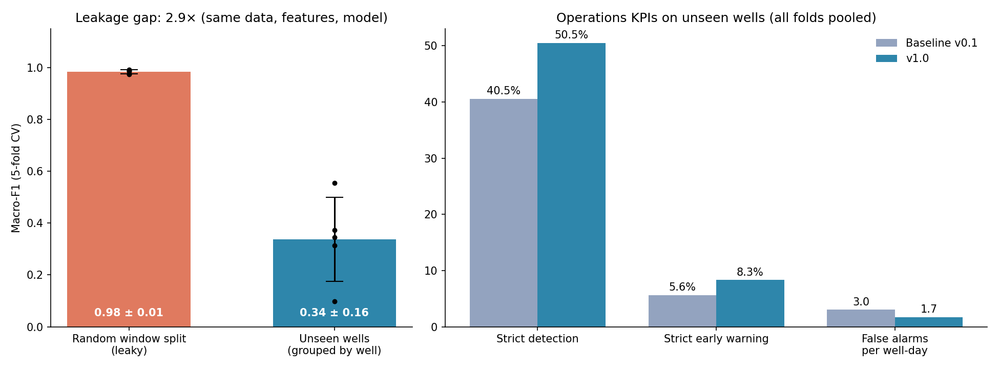

# 🛢️ WellSentinel-3W

[](https://github.com/alialhooti217-cmd/WellSentinel-3W/actions/workflows/tests.yml)


**An early-warning system for undesirable events in offshore oil wells (hydrates, valve closures, scaling,
slugging), evaluated the way a control room would judge it: on wells it has never seen, in events caught,
minutes of warning and false alarms per day.** A random train/test split makes this model look almost perfect
(macro-F1 0.98). On unseen wells it scores 0.34. This repository measures that gap, shows what the model
really learned, and uses flow-assurance physics (pressure oscillation and drift) to cut false alarms by 43 %.

Author: **Ali Al Hooti**, Chemical & Process Engineer (SQU) · Data: Petrobras 3W v2.0.0 (CC BY 4.0)

<p align="center"></p>

---

## 📈 Results v1.0 (unseen wells, 5-fold cross-validation grouped by well)

40 real wells, 481 real event instances. Simulated and hand-drawn data are used for training only. Every
number below comes from [`reports/final_results.json`](reports/final_results.json); a test fails if a doc quotes
a headline number that is not in that file.

| KPI (unseen wells) | Baseline v0.1 | **v1.0** | Target |
|---|---|---|---|
| Macro-F1 (mean ± std over 5 folds) | 0.32 ± 0.17 | **0.34 ± 0.16** | ≥ 0.70 |
| Balanced accuracy | 0.362 ± 0.142 | **0.375 ± 0.139** | |
| Event detection rate (strict) | 40.5 % | **50.5 %** | ≥ 90 % |
| Early-warning rate (strict, caught while still developing) | 5.6 % | **8.3 %** | ≥ 60 % |
| Median detection delay (strict) | 5 min | **5 min** | ≤ 15 min |
| False alarms per well-day | 3.0 | **1.7** | ≤ 1 |

**Strict** means the alarm must be **off** when the event starts and then fire. An alarm already ringing before
onset counts as a false alarm, not a catch. v1.0 improves strict detection on 4 of 5 folds and lowers false
alarms on 4 of 5 folds (43 % fewer overall). The macro-F1 gain is within fold-to-fold noise; the honest headline
is fewer false alarms and more events caught, not a better classifier.

<p align="center"></p>

**The leakage gap.** Same data, same features, same model, only the split changes: a random window-level 5-fold
split scores **0.98 ± 0.01** macro-F1, which is **2.9× higher** than unseen wells (0.34 ± 0.16). Neighbouring windows of the same
well land on both sides of a random split, so the model memorises the well rather than the event.
Per class and per fold: [`reports/final_results.md`](reports/final_results.md).

| Event (real instances) | F1 v1.0 | Strict detection v1.0 | Comment |
|---|---|---|---|
| Hydrate in production line (14) | 0.89 | 79 % | Partly an **instrumentation fingerprint**: without T-MON-CKP (on 9 of 40 wells) F1 0.77; with common sensors only 0.50 |
| Spurious DHSV closure (22) | 0.53 | 77 % | Flow stops: the Xmas tree cools and depressurises |
| Flow instability (343) | 0.17 | 51 % | Works on one group of wells, does not transfer to the others |
| Scaling in production choke (36) | 0.15 | 14 % | Slow, subtle drift |
| Severe slugging (32) | 0.00 | 88 % (see below) | 31 of 32 instances come from one well; type never identified |
| BSW increase (4), PCK restriction (6), productivity loss (11), hydrate in service line (13) | ≈ 0 | 0–45 % | Too few real examples to learn or to judge |

---

## 🔍 What the model really learned

Permutation importance on unseen wells, grouped by physical sensor ([E03 + E10](docs/WORK_LOG.md)):

- **It is not an operator-action detector.** Valve states, gas-lift rate and choke openings carry only 9 % of the
  importance; removing all of them changes macro-F1 by less than the fold-to-fold noise.
- **It is mostly a "flow stopped, well cooling" detector.** The top signals are the Xmas-tree temperature,
  the temperature upstream of the production choke and the Xmas-tree pressure. A spurious DHSV closure is recognised
  because flow stops, so the tree cools and depressurises. That is real physics, but it is the *consequence* of the event,
  not a precursor, which is why early warning stays low.
- **Hydrate alarms ride on two shortcuts.** (1) The T-MON-CKP temperature sensor exists in every
  hydrate-in-production-line window and on only 9 of 40 wells, so part of the skill is "this well has that sensor".
  (2) In many hydrate events gas lift drops to zero at onset. Physically that is a valid trigger (no flow, the line
  cools into the hydrate envelope), but it is an operator/equipment action. The dashboard's "Explain this alarm"
  shows this directly.
- **Process physics that did help:** oscillation power of the tree and choke pressures in a 2–60 min band.
  A healthy well is quiet in that band, so many "noisy but normal" windows stop raising alarms (false alarms
  3.0 → 1.7 per well-day). Live drift (pressure now vs. 1–3 h ago) added detections at no false-alarm cost.

## 🧪 What didn't work, and why (negative results are kept)

All experiments are in [`docs/WORK_LOG.md`](docs/WORK_LOG.md) (E00–E10), judged by one rule: strict detection
better on ≥ 3 of 5 folds **and** false alarms not higher.

- **ΔP levels act as a well ID.** Pressure differences across the choke, tubing and flowline *hurt* (scaling F1 → 0).
  A tubing ΔP level is roughly the hydrostatic head, a per-well constant. Keeping only ΔP dynamics makes it
  neutral, which supports that explanation.
- **Severe slugging is a data limit, not a feature problem.** Real slugging is obvious in the oscillation
  features (choke-pressure swings of ~10 bar vs ~0.2 bar normally, cycle ≈ 80 min). But 31 of 32 real instances come from
  one well, so when that well is held out the model learns slugging from *simulations* (cycle ≈ 51 min, much
  smaller swings) and never recognises the real thing. Training on real data only floods the control room with false alarms;
  rescaling the simulations did not pass the rule either.
- **Start-of-file drift is an artefact.** "Pressure vs. the first hour of the recording" looked useful, but 3W
  files are cut to start near-normal, so it leaks the dataset design. The deployable version (vs. 1–3 h ago) is used.
- **Per-well normalisation against a trailing window** delayed detection (median delay 5 → 22.5 min):
  a slowly developing event raises its own reference.
- **Wider 2–120 min band, availability masks:** no gain (the tree model already reads missing-sensor patterns).

---

## 🧠 Method

```
3W parquet (1 Hz, 27 sensors)                            real + simulated + hand-drawn instances
   │  01  inventory + well-grouped folds (StratifiedGroupKFold by WELL; a well is never in train and test)
   ▼
15-min windows every 5 min
   ├─ 6 stats per sensor: mean, std, min, max, last, slope                    (base, 132 features)
   ├─ oscillation: FFT power + dominant period, 2–60 min band, 120-min causal history   (OSC-)
   └─ live drift: pressure now − mean over [t−3h, t−1h]                       (DRIFTR-)  → 145 features
   │  02
   ▼
HistGradientBoosting (NaN-native, class-balanced)        trained on real training wells + simulated + drawn
   │  06 grouped 5-fold CV  ·  03 --all-real = deployable model (all wells)
   ▼
P(abnormal) ≥ 0.5 for 2 consecutive windows  ──►  ALARM  +  "Explain this alarm" (top sensors, plain words)
   │
   ▼
Window metrics (macro-F1)  +  strict event KPIs (detection, delay, early warning, false alarms / well-day)
```

- **Labels:** the label at the end of each window; transient classes (101–109) mapped to their event with an
  `is_transient` flag, used to measure early warning.
- **No leakage:** folds are grouped by well; simulated and drawn instances never enter a test fold; all physics
  features are causal (a window only sees the past).
- **Dashboard replay is honest:** a well is shown with the predictions of the cross-validation model that never saw it.

---

## 🚀 Quick start

```powershell
# 1. one-time setup (creates .venv and installs everything)
powershell -ExecutionPolicy Bypass -File setup_env.ps1

# 2. pipeline (Windows; on Linux/macOS use .venv/bin/python)
.venv\Scripts\python scripts/00_download_data.py       # ~1.9 GB, resumable
.venv\Scripts\python scripts/01_build_inventory.py     # catalogue + well-grouped folds
.venv\Scripts\python scripts/02_build_features.py      # windows -> data/processed/features_physics.parquet
.venv\Scripts\python scripts/06_cross_validation.py --recommended --tag v1                      # grouped CV
.venv\Scripts\python scripts/06_cross_validation.py --recommended --schemes random --tag v1_random  # leakage gap
.venv\Scripts\python scripts/03_train_baseline.py --all-real                                   # deployable model
.venv\Scripts\python scripts/09_results_table.py       # reports/final_results.{json,md}
.venv\Scripts\python scripts/05_social_figures.py      # figures + facts sheet

# 3. dashboard
.venv\Scripts\streamlit run app/streamlit_app.py

# tests (synthetic data, no download needed)
.venv\Scripts\python -m pytest -q
```

Long runs take `--folds` and `--max-iter`; one model fit is ~1–2 min on a laptop. All experiments:
`bash scripts/run_release_experiments.sh`. Project conventions: [`CLAUDE.md`](CLAUDE.md).

<details><summary>Project structure</summary>

```
WellSentinel-3W/
├── app/streamlit_app.py        # control-room replay dashboard (+ DEMO_MODE)
├── configs/config.yaml         # windows, physics features, split, model.recommended, alarm
├── data/                       # (git-ignored) raw 3W parquet, inventory, features
├── demo/                       # small real-instance subset for Streamlit Community Cloud
├── docs/                       # work log, model & data cards, launch kit, presentation, plan
├── marketing/assets/           # rule-picked figures + facts sheet
├── models/                     # (git-ignored) model bundles
├── reports/                    # CV results, final_results.{json,md}, figures
├── scripts/                    # 00 download … 09 results table
├── src/wellsentinel/           # package: data, features, split, cv, models, evaluate, explain, io
└── tests/                      # pytest (CI, no dataset needed) incl. a docs-numbers guard
```
</details>

---

## ⚠️ Limitations

- **Decision support, not a safety system.** It does not replace SIS/ESD logic or an operator's judgement.
- **Performance varies strongly between wells:** macro-F1 ranges from 0.10 to 0.55 across folds.
- **Sensor availability differs per well** and the model partly exploits which sensors exist (hydrate caveat above).
- **Rare events** (BSW increase, PCK restriction, productivity loss, hydrate in service line) have too few real
  instances to learn or to evaluate; severe slugging is effectively tested on one well.
- **Early warning is rare:** most detections happen after the event has started. Temperature signals react to
  the consequence of an event.
- Trained on Petrobras offshore wells; other fields, completions and lift methods need re-validation.

## 📚 Data, citation and licence

> 3W Dataset © Petrobras, licensed under **CC BY 4.0**: https://github.com/petrobras/3W
> Vargas, R.E.V., Munaro, C.J., Ciarelli, P.M., Medeiros, A.G., do Amaral, B.G., Barrionuevo, D.C., de Araújo,
> J.C.D., Ribeiro, J.L., Magalhães, L.P. (2019). *A realistic and public dataset with rare undesirable real events
> in oil wells.* Journal of Petroleum Science and Engineering, 181, 106223. https://doi.org/10.1016/j.petrol.2019.106223

The data is not stored in this repo (download with `scripts/00_download_data.py`); the small `demo/` subset is
redistributed under CC BY 4.0 with attribution. To cite this project, see [`CITATION.cff`](CITATION.cff).
Changes per version: [`CHANGELOG.md`](CHANGELOG.md).

## 🤝 Contact

Interested in flow assurance, production surveillance or industrial ML? Open an issue or reach out on LinkedIn.
